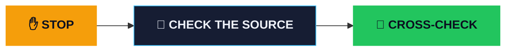

<div class="bg-fade-left"></div>

<div v-motion :initial="{ y: 40, opacity: 0 }" :enter="{ y: 0, opacity: 1, transition: { duration: 700 } }">

<div class="flex gap-4 text-5xl mb-6">
  <span class="i-twemoji-flag-malaysia"></span>
  <span class="i-twemoji-magnifying-glass-tilted-left"></span>
  <span class="i-twemoji-flag-indonesia"></span>
</div>

<h1 class="!text-7xl !mb-3">Saring Sebelum <span class="text-pause">Sharing</span></h1>

<p class="!text-3xl text-muted">Check Before You Share</p>

</div>

<div class="mt-12 text-xl text-muted" v-motion :initial="{ opacity: 0 }" :enter="{ opacity: 1, transition: { delay: 600 } }">
  Web Team · Townhall · 6 Nov 2026
</div>

<!--
**⏱ 0:00 → 0:15 · 15 sec** · *Smile, wave at the camera too.*

Selamat pagi, everyone! Hi to everyone in the office, and hi to everyone joining remotely. *(wave at camera)*

Today's talk is four words long: **saring sebelum sharing**. Works in Bahasa Malaysia, works in Bahasa Indonesia. Filter before you forward.

But first: a game.
-->

---
layout: image-right
image: /assets/magnifier.jpg
backgroundSize: cover
transition: fade-out
---

# Quick game: <span class="text-real">real</span> or <span class="text-fake">fake</span>?

<div class="grid grid-cols-1 gap-5 mt-8 text-2xl">
  <div class="card" v-click>
    <span class="i-twemoji-flag-indonesia text-4xl"></span>
    <div class="mt-2">Indonesians vote on <span class="i-twemoji-flag-malaysia"></span> Malaysian items</div>
  </div>
  <div class="card" v-click>
    <span class="i-twemoji-flag-malaysia text-4xl"></span>
    <div class="mt-2">Malaysians vote on <span class="i-twemoji-flag-indonesia"></span> Indonesian items</div>
  </div>
</div>

<p class="mt-8 text-muted" v-click>No Googling. Gut feeling only. <span class="i-twemoji-eyes"></span></p>

<!--
**⏱ 0:15 → 0:30 · 15 sec**

Quick game: real or fake? I'll show you four things that went viral, two from Malaysia, two from Indonesia.

[click] Here's the twist. Indonesian friends: you judge the **Malaysian** ones.

[click] Malaysian friends: you judge the **Indonesian** ones. So nobody gets the home advantage.

[click] Rules: no Googling. *(look at the camera)* Remote team, I can see you opening a new tab. Gut feeling only!
-->

---
clicks: 0
---

# Real or fake?

<div class="grid grid-cols-4 gap-4 mt-4 h-80">
  <FlipCard label="Every Malaysian adult gets RM100 credited to their MyKad. No application needed." kind="A · Headline" flag="my" verdict="REAL" image="/assets/hoax/my-sara-photo.jpg" view-href="https://www.thevibes.com/articles/news/112204/rm100-sara-aid-via-mykad-begins-nationwide-distribution" />
  <FlipCard label="Finance Minister Sri Mulyani: “guru itu beban negara” (teachers are a burden on the state)" kind="B · Video" flag="id" verdict="FAKE" image="/assets/hoax/id-srimulyani-video.jpg" view-href="/assets/hoax/id-srimulyani-viral.mp4" extra-href="https://www.youtube.com/watch?v=Zh02Lzk6px8" extra-label="Real speech ▶" />
  <FlipCard label="TikTok: customer rages at JPJ, “only 1 counter open, staff still on break!”" kind="C · Video" flag="my" verdict="FAKE" image="/assets/hoax/my-jpj-tiktok.jpg" :image-blur="3.5" play />
  <FlipCard label="“KISAH NYATA: man arrested for hoarding coins in water gallons”" kind="D · Image" flag="id" verdict="FAKE" image="/assets/hoax/id-koin-ai.png" view-href="https://www.lpkapnews.com/2026/02/nimbun-uang-koin-di-galon-air-pria-ini.html" />
</div>

<p class="mt-4 text-center text-muted">Pick A, B, C, D: which ones are <span class="text-real">real</span>?</p>

<!--
**⏱ 0:30 → 1:15 · 45 sec** · *~10 sec per card. "Open ↗" opens the item (A, B, D). C has no copy online, so just describe it.*

Okay, four items. Look carefully.

**A, Malaysia.** "Every Malaysian adult gets RM100 credited to their MyKad. No application needed." Free money from the government, straight to your IC. Hmm.

**B, Indonesia.** A clip of Finance Minister Sri Mulyani saying *"guru itu beban negara"*, teachers are a burden on the state. *(optional: click "Open ↗" and play a few seconds, then close the tab)*

**C, Malaysia.** A TikTok from a JPJ office. A customer is furious: "Only one counter open, staff still on break!" Over twenty-eight thousand likes.

**D, Indonesia.** "Kisah nyata", a true story: a man arrested by police for hoarding coins in water gallons. There's even a photo.

So: which of these are **real**? Don't tell me yet. Next slide.
-->

---
layout: center
---

# Cast your vote <span class="i-twemoji-backhand-index-pointing-down"></span>

<div class="h-80 mt-4 w-200">
  <PollEmbed url="POLL_URL_HERE" title="Real or fake? A · B · C · D" />
</div>

<!--
**⏱ 1:15 → 1:45 · 30 sec** · *TODO: paste the poll URL into PollEmbed first. If the venue Wi-Fi blocks the iframe, the QR + link still work.*

Vote now! Office: scan the QR code with your phone. Remote friends: the link is in the chat. *(paste the link into the chat now)*

Pick every one you think is **real**. You've got about twenty seconds.

*(While people vote:)* I'll give you a hint: at least one of them is real. Maybe more. Maybe less. *(smile)*

*(Glance at results)* Ooh, interesting. Some very confident people here. Let's find out.
-->

---
clicks: 5
---

# The reveal

<div class="grid grid-cols-4 gap-4 mt-4 h-80">
  <FlipCard label="Every Malaysian adult gets RM100 credited to their MyKad. No application needed." kind="A · Headline" flag="my" verdict="REAL" image="/assets/hoax/my-sara-photo.jpg" view-href="https://www.thevibes.com/articles/news/112204/rm100-sara-aid-via-mykad-begins-nationwide-distribution" reason="SARA one-off RM100, usable 31 Aug–31 Dec 2025." back-image="/assets/screenshots/my-sara.png" href="https://www.thevibes.com/articles/news/112204/rm100-sara-aid-via-mykad-begins-nationwide-distribution" :flipped="$clicks >= 1" />
  <FlipCard label="Finance Minister Sri Mulyani: “guru itu beban negara” (teachers are a burden on the state)" kind="B · Video" flag="id" verdict="FAKE" image="/assets/hoax/id-srimulyani-video.jpg" view-href="/assets/hoax/id-srimulyani-viral.mp4" extra-href="https://www.youtube.com/watch?v=Zh02Lzk6px8" extra-label="Real speech ▶" reason="She never said it. Real speech, cut + fake caption. She called it HOAX." back-image="/assets/screenshots/id-srimulyani.png" href="https://ekonomi.republika.co.id/berita/t18wf6409/sri-mulyani-bantah-sebut-guru-beban-negara-cap-video-viral-hoaks-hasil-deepfake" :flipped="$clicks >= 2" />
  <FlipCard label="TikTok: customer rages at JPJ, “only 1 counter open, staff still on break!”" kind="C · Video" flag="my" verdict="FAKE" image="/assets/hoax/my-jpj-tiktok.jpg" :image-blur="3.5" play reason="AI-generated. JPJ denied it and reported it to MCMC." back-image="/assets/screenshots/my-jpj.png" href="https://utusanmelayuplus.com/jpj-nafi-video-kononnya-petugas-bergaduh-dengan-pelanggan-dipercayai-dijana-ai/" :flipped="$clicks >= 3" />
  <FlipCard label="“KISAH NYATA: man arrested for hoarding coins in water gallons”" kind="D · Image" flag="id" verdict="FAKE" image="/assets/hoax/id-koin-ai.png" view-href="https://www.lpkapnews.com/2026/02/nimbun-uang-koin-di-galon-air-pria-ini.html" reason="AI image (97%, TruthScan). Source tagged it #ceritafiksi." back-image="/assets/hoax/id-koin-factcheck.png" href="https://www.kompas.com/cekfakta/read/2026/03/02/113300182/-hoaks-foto-pria-ditangkap-polisi-karena-timbun-uang-koin" :flipped="$clicks >= 4" />
</div>

<div v-click="5" class="mt-5 text-center text-4xl font-bold" v-motion :initial="{ scale: 0.8 }" :enter="{ scale: 1 }">
  Everyone can be fooled.
</div>

<button v-if="['slide', 'presenter'].includes($renderContext)" class="skip-btn" title="Jump to the next slide without flipping the cards" @click.stop="$nav.nextSlide()">Skip reveal <span class="i-carbon-skip-forward-filled"></span></button>

<!--
**⏱ 1:45 → 2:15 · 30 sec** · *Arrow key / clicker flips one card per click. Short on time? "Skip reveal" (top-right) jumps to the next slide.*

Let's see how you did. Card A, the RM100…

[click] **Real!** *(pause)* SARA, Sumbangan Asas Rahmah. Every Malaysian eighteen and above really got RM100 on their MyKad. So "too good to be true" isn't proof either. You still have to check.

[click] Card B, Sri Mulyani… **fake.** She never said it. Someone took her real speech at ITB, cut it, and slapped a fake caption on it. Real clip, fake caption: still fake. *(Optional: "Real speech ▶" on the card opens the original speech.)*

[click] Card C, the angry JPJ customer: **fake.** AI-generated. JPJ denied it and reported it to MCMC.

[click] Card D, the coin hoarder: **fake.** An AI image, and the original page even tagged it "cerita fiksi". Fiction. But it got shared as news.

[click] So, hands up if you got all four right. *(look at room and camera)* …Not many. That's the point.

**Everyone can be fooled.** *(pause a beat)*
-->

---
layout: image-left
image: /assets/phone-glow.jpg
backgroundSize: cover
class: flex flex-col justify-center
---

<div class="text-5xl font-bold leading-tight">
  Not a <span class="line-through text-muted">boomer</span> problem.<br>
  A <span class="text-pause">human</span> problem.
</div>

<p v-click class="mt-10 !text-3xl text-muted">
  Boomers just have bigger WhatsApp groups. <span class="i-twemoji-busts-in-silhouette"></span>
</p>

<!--
**⏱ 2:15 → 2:30 · 15 sec** · *Warm, not mocking.*

And this is important: it's not a boomer problem. You just saw a room full of tech people get fooled. It's a **human** problem.

[click] Boomers just have bigger WhatsApp groups. *(let them laugh, then move on)*
-->

---

# The scale <span class="text-muted text-2xl">· it's not just your family group</span>

<div class="grid grid-cols-2 gap-8 mt-6">
  <div class="card card-fake text-center">
    <div class="flex items-center justify-center gap-2 text-xl"><span class="i-twemoji-flag-malaysia text-3xl"></span> Malaysia · MCMC</div>
    <div class="text-6xl font-bold mt-3 text-fake"><CountUp :to="63215" /></div>
    <div class="text-xl mt-1">false content items flagged to platforms<br><span class="text-muted text-base">Jan 2022 – May 2026</span></div>
    <div class="text-3xl font-bold mt-3"><CountUp :to="86" suffix="%" :duration="1500" /> <span class="text-xl font-normal">taken down</span></div>
  </div>
  <div class="card card-fake text-center">
    <div class="flex items-center justify-center gap-2 text-xl"><span class="i-twemoji-flag-indonesia text-3xl"></span> Indonesia · Mafindo</div>
    <div class="text-6xl font-bold mt-3 text-fake"><CountUp :to="1593" /></div>
    <div class="text-xl mt-1">hoaxes logged in one year<br><span class="text-muted text-base">Oct 2024 – Oct 2025</span></div>
    <div class="text-xl mt-3">many using <span class="text-pause font-bold">AI deepfakes</span></div>
  </div>
</div>

<div class="mt-5 flex justify-center">
  <span class="chip"><b>hoaks</b> <span class="i-twemoji-flag-indonesia"></span> &nbsp;=&nbsp; <b>berita palsu / tular</b> <span class="i-twemoji-flag-malaysia"></span></span>
</div>

<div class="footnote">
  Sources: MCMC takedown figures — The Sun (thesun.my/?p=644239) · Mafindo report — Okezone (economy.okezone.com, 23 Oct 2025)
</div>

<!--
**⏱ 2:30 → 4:00 · 1.5 min** · *The counters animate on their own. Don't read the numbers twice.*

So how big is this? Let's look at both countries.

**Malaysia.** Between January 2022 and May 2026, MCMC asked platforms to take down sixty-three thousand false content items. *(point at the counter)* And eighty-six percent of them were taken down.

**Indonesia.** Mafindo, the anti-hoax society, logged one thousand five hundred and ninety-three hoaxes in just one year, from October 2024 to October 2025. And a lot of them used AI deepfakes.

And remember: these are only the ones that got **caught and counted**. The real number is much bigger.

*(point at the term box)* By the way, same problem, different words. In Indonesia we say **hoaks**. In Malaysia you say **berita palsu**, or when it spreads, it's **tular**.

Quick one for the room: Indonesians, did you know the word *tular*? Malaysians, *hoaks*? *(quick show of hands, then move on)*
-->

---

# Same playbook, two countries

<div class="grid grid-cols-2 gap-8 mt-4">
  <div v-click>
    <div class="flex items-center gap-2 text-2xl font-bold"><span class="i-twemoji-flag-malaysia text-3xl"></span> Malaysia</div>
    <p class="!text-xl mt-2">Deepfake videos of <b>PM Anwar Ibrahim</b> and business figures pushing <span class="text-fake">fake investment schemes</span></p>
    <a href="https://incidentdatabase.ai/entities/anwar-ibrahim/" target="_blank" rel="noopener" class="source-link" title="Open source article"></a>
  </div>
  <div v-click>
    <div class="flex items-center gap-2 text-2xl font-bold"><span class="i-twemoji-flag-indonesia text-3xl"></span> Indonesia</div>
    <p class="!text-xl mt-2">Deepfake of <b>President Prabowo</b> offering <span class="text-fake">"government aid"</span>. Suspect arrested Jan 2025, victims across <b>20 provinces</b></p>
    <a href="https://www.hukumonline.com/berita/a/deepfake-menyebar-cepat--hukum-bergerak-lambat-lt68f065103ad53" target="_blank" rel="noopener" class="source-link" title="Open source article"></a>
  </div>
</div>

<div class="footnote">
  Sources: AI Incident Database (incidentdatabase.ai/entities/anwar-ibrahim) · Hukumonline (hukumonline.com, "Deepfake Menyebar Cepat, Hukum Bergerak Lambat")
</div>

<!--
**⏱ 4:00 → 5:00 · 1 min** · *Stay neutral: this is about scammers abusing famous faces, not about the leaders or politics. Screenshots open the articles.*

Now here's what made me want to give this talk. The scams look **exactly the same** in both countries.

[click] In Malaysia: deepfake videos of Prime Minister Anwar Ibrahim, and of well-known business figures, used to push fake investment schemes. "Invest with me, guaranteed returns."

[click] In Indonesia: a deepfake of President Prabowo offering "government aid". In January 2025, police arrested a suspect, and the victims were spread across twenty provinces.

Different country. Different leader. *(pause)* Did you notice what's the same? Hold that thought.
-->

---
clicks: 4
---

# Spot the pattern

<div class="mt-10">
  <ScamPattern :step="$clicks" />
</div>

<p class="mt-10 text-center text-muted" v-if="$clicks >= 4">Different country, different face. <b class="text-[var(--ss-text)]">Same script.</b></p>

<!--
**⏱ 5:00 → 6:00 · 1 min** · *The "wow" of this section: one piece per click.*

Let's break down the script. Every one of these scams has three ingredients.

[click] One: a **famous face**. A leader, a celebrity, someone you trust. Often deepfaked now.

[click] Two: **free money**. "Bantuan", "investment", "guaranteed returns".

[click] Three: a **WhatsApp number**. "Contact my admin to claim."

[click] Put them together, and it's a **scam**. Every single time.

Here's the good news: you don't need to know if the video is real or AI. You don't need to be an expert. If you see those three things together: **it's a scam.** Done.

*(Ask the room:)* Has anyone here seen one of these in their own feed? *(nod, quick acknowledgement)* Yeah. Most of us have.
-->

---

# Why do we share? <span class="i-twemoji-thinking-face"></span>

<v-clicks>

- <span class="i-twemoji-red-heart mr-2"></span> **Sharing = caring:** forwarding shows love; accuracy gets skipped
- <span class="i-twemoji-old-man mr-2"></span> **Trust the sender, not the content:** "Uncle wouldn't lie"
- <span class="i-twemoji-repeat-button mr-2"></span> **Repetition feels true:** the *illusory truth effect*
- <span class="i-twemoji-face-screaming-in-fear mr-2"></span> **Emotion beats reason:** fear, anger, urgency
- <span class="i-twemoji-umbrella mr-2"></span> **"Just in case" logic:** sharing feels free

</v-clicks>

<style>
ul { padding-left: 0; }
li { list-style: none; }
</style>

<!--
**⏱ 6:00 → 7:45 · 1 min 45 sec** · *~20 sec per point. Ask the room before revealing, if time allows.*

So if these are so easy to spot, why do smart people still forward them? Let me ask you first: why do **you** forward things? *(pause 2 seconds, let someone answer, or continue)*

[click] **Sharing is caring.** In the family group, forwarding is how we show love. "Hati-hati ya, semua!" We care about the people, so we skip checking whether it's true.

[click] **We trust the sender, not the content.** "Uncle wouldn't lie." And he didn't! He just didn't check either.

[click] **Repetition feels true.** When you see the same message in five different groups, it starts to feel true. Psychologists call this the *illusory truth effect*.

[click] **Emotion beats reason.** Fear, anger, urgency. "URGENT! Share before it's deleted!" Strong emotion switches off the part of the brain that asks, "wait, is this true?"

[click] And finally: **"just in case."** "If it's fake, no harm done, right?" But sharing isn't free. It costs trust, and sometimes it costs people real money.

*(Ask:)* Which one is you? Be honest. For me, it's number one. *(smile)*
-->

---


<div class="bg-fade-full"></div>

# Different ages, different traps

<div class="grid grid-cols-2 gap-8 mt-6">
  <div class="card card-pause" v-click>
    <div class="text-2xl font-bold flex items-center gap-2"><span class="i-twemoji-older-person text-3xl"></span> Older</div>
    <ul class="mt-3">
      <li>Grew up when <i>published = edited</i></li>
      <li>Newer to digital tools</li>
    </ul>
  </div>
  <div class="card card-pause" v-click>
    <div class="text-2xl font-bold flex items-center gap-2"><span class="i-twemoji-man-technologist text-3xl"></span> Younger</div>
    <ul class="mt-3">
      <li>Speed: scroll, react, repost</li>
      <li>Trust in influencers</li>
      <li>Reposting for engagement</li>
    </ul>
  </div>
</div>

<p v-click class="mt-8 text-center">Nobody is immune. <span class="text-pause">Just different blind spots.</span></p>

<!--
**⏱ 7:45 → 8:30 · 45 sec** · *Not mocking either side.*

And different generations fall for it in different ways.

[click] Our parents grew up when anything **published** had passed an editor. If it's in the newspaper, someone checked it. That instinct made sense then. Now anyone can publish anything. And many of them are newer to these digital tools.

[click] And us, the younger ones? We're **fast**. Scroll, react, repost. We trust influencers. And sometimes we repost for the likes, not because it's true.

[click] So nobody is immune. We just have **different blind spots**.
-->

---
layout: image-right
image: /assets/family-phone.jpg
backgroundSize: cover
class: flex flex-col justify-center
---

<div class="text-6xl mb-6"><span class="i-twemoji-speech-balloon"></span></div>

# Drop the weirdest hoax your family group sent you <span class="i-twemoji-backhand-index-pointing-down"></span>

<p class="text-muted mt-6">Remote: type it in the chat · Office: shout it out</p>

<!--
**⏱ 8:30 → 9:00 · 30 sec** · *Hybrid moment. Read 1–2 from the chat + 1 from the room. Skip anything touching race, religion, royalty or politics.*

Okay, your turn! What's the **weirdest hoax your family group has ever sent you?**

Remote friends: type it in the chat right now. Office: just shout it out!

*(Read 1–2 from the chat aloud: "Oh, [name] says…!" React, laugh.)*

*(Take one from the room.)*

*(If it's quiet, use your own:)* TODO: your own family-group hoax story, one or two sentences.

Love it. Thank you! Okay, let's talk about a different kind of misinformation.
-->

---

# Advice overload <span class="i-twemoji-high-voltage"></span>

````md magic-move {lines: false}
```yaml
post:  "❌ NEVER do X again!!! 😱"
hook:  "You've been doing it WRONG your whole life!"
proof: "Doctors don't want you to know this..."
cta:   "Link in bio 👉 my course"
```
```yaml {1|2|3|4|all}
post:  "❌ NEVER do X again!!! 😱"   # 🚩 absolute words
hook:  "You've been doing it WRONG"  # 🚩 guilt
proof: "Doctors don't want you…"     # 🚩 no source
cta:   "Link in bio 👉 my course"    # 🚩 selling something
```
```yaml
source: KKM / Kemenkes / WHO
says:   "X may not suit everyone."
next:   "Ask your doctor what's right for you."
```
````

<p v-click class="mt-6 text-center text-muted">Short videos sell <span class="text-fake">certainty</span>. Real advice sounds <span class="text-real">calm</span>.</p>

<!--
**⏱ 9:00 → 9:45 · 45 sec** · *Magic Move: each click lights up one red flag.*

This one isn't a scam. It's **advice**. You've all seen videos like this. *(read it dramatically)* "NEVER do X again! You've been doing it WRONG your whole life! Doctors don't want you to know this… Link in bio."

Let's look closer.

[click] "NEVER": **absolute words**. Real experts almost never talk like that.

[click] "You've been doing it wrong": **guilt**. Makes you anxious, makes you keep watching.

[click] "Doctors don't want you to know": **no source**. Which doctors? Says who?

[click] "Link in bio": **selling something**. Follow the money.

[click] Four red flags. In one fifteen-second video.

[click] Now here's what real health advice sounds like. "Guidelines from KKM, Kemenkes, WHO suggest X may not suit everyone. Ask your doctor." *(pause)* Boring, right?

[click] And that's exactly the point. Short videos sell **certainty**. Real advice sounds **calm**. If it's thrilling and absolutely certain, be suspicious.
-->

---

# Trust <span class="text-real">consensus</span>, not <span class="text-fake">content</span>

<div class="grid grid-cols-2 gap-8 mt-4">
  <div class="card card-real">
    <div class="font-bold text-2xl text-real">Consensus</div>
    <p class="!text-xl mt-2">KKM · Kemenkes · IDAI · WHO · <b>your doctor</b></p>
  </div>
  <div class="card card-fake">
    <div class="font-bold text-2xl text-fake">Content</div>
    <p class="!text-xl mt-2">One creator · 30 seconds · no context</p>
  </div>
</div>

<div v-click class="mt-6 flex flex-wrap gap-3 justify-center">
  <span class="chip"><span class="i-twemoji-warning"></span> Absolute words</span>
  <span class="chip"><span class="i-twemoji-money-bag"></span> Selling something</span>
  <span class="chip"><span class="i-twemoji-bar-chart"></span> "One study says"</span>
  <span class="chip"><span class="i-twemoji-cross-mark"></span> No source</span>
</div>

<p v-click class="mt-6 text-center !text-xl text-muted">"We survived fine back then" is partly <b>survivorship bias</b>. Some new advice is real: baby back-sleeping, car seats.</p>

<!--
**⏱ 9:45 → 11:00 · 1 min 15 sec**

So who should we trust? Here's my simple rule: trust **consensus**, not **content**.

Consensus is KKM, Kemenkes, IDAI, the WHO, and **your own doctor**: many experts, many studies, agreeing.

Content is one creator, thirty seconds, no context.

*(Ask:)* Quick show of hands: who has changed a habit because of a TikTok or Reels video? *(raise your own hand)* Me too. No judgement!

[click] So when you watch advice, look for these red flags: absolute words, selling something, "one study says", and no source at all.

[click] And one balancing point, because I know someone's thinking it: "We survived fine back then!" *(smile)* Partly, that's **survivorship bias**: we only hear from the people who survived. Some new advice really is better. Putting babies to sleep on their backs. Car seats.

So the lesson isn't "ignore all new advice". It's: **check who's behind it.**
-->

---

# Your 3-step toolkit



<div v-click class="card card-fake mt-8 flex items-center gap-4">
  <span class="i-twemoji-robot text-5xl shrink-0"></span>
  <div>
    <div class="font-bold text-2xl"><span class="text-fake">AI rule:</span> public figure + money + WhatsApp = scam</div>
    <div class="text-xl text-muted mt-1">Verify via official channels. Don't judge by eye.</div>
  </div>
</div>

<!--
**⏱ 11:00 → 11:30 · 30 sec**

So what do we actually **do**? Three steps. Easy to remember.

**Stop.** That itch to forward right now? That's your signal to pause.

**Check the source.** Who made this? A real news outlet? An official account? Or "a friend of a friend"?

**Cross-check.** Is anyone else credible reporting it? Is there already a fact-check?

[click] And one special rule for AI. Deepfakes are now too good to spot by eye, so don't even try. If a public figure is offering you money through WhatsApp: **it's a scam.** Verify through official channels.
-->

---

# Anatomy of a suspicious link <span class="i-twemoji-link"></span>

````md magic-move {lines: false}
```yaml
link: https://bantuan-pemerintah.gov.my.claim-now.site/daftar
```
```yaml {2|3|4}
link: https://
  - bantuan-pemerintah.gov.my.   # decoration (subdomain)
  - claim-now.site               # 🚩 the REAL domain
  - /daftar                      # just the page
```
```yaml
owner: claim-now.site
is_gov_my: false   # ❌ not the government
```
````

<p v-click class="mt-6 text-center">Read the domain <b>right before the first <code>/</code></b>. That's the owner.</p>

<div class="footnote">Fictional URL for illustration only.</div>

<!--
**⏱ 11:30 → 12:00 · 30 sec** · *Fictional URL.*

Let's practise checking the source. Here's a link. *(read it)* bantuan-pemerintah dot gov dot my… looks official, right? *(Ask:)* Who would click this? *(pause)*

[click] Let's break it down. This first part, "bantuan-pemerintah.gov.my", is just decoration. Anyone can type that.

[click] **This** is the real domain: claim-now dot site.

[click] And "/daftar" is just the page.

[click] So who owns this link? Claim-now dot site. Not the government.

[click] Here's the trick: read the part **right before the first slash**. That's the owner. Everything before it can be fake.
-->

---

# The forwarded message <span class="i-mdi-whatsapp text-real"></span>

````md magic-move {lines: false}
```yaml
forwarded: many times
message: "URGENT!!! 🚨 Share to ALL groups before it's deleted!"
offer:   "FREE aid for every family, claim before midnight!"
action:  "Pay small admin fee here 👉 [link]"
```
```yaml {1|2|3|4|all}
forwarded: many times    # 🚩 nobody you know wrote it
message: "URGENT!!! 🚨…"  # 🚩 urgency + asks to share
offer:   "FREE aid…"     # 🚩 no source, no name, no date
action:  "Pay admin fee" # 🚩 asks you to pay
```
```yaml
red_flags: 4
verdict: ✋ STOP
check: [Sebenarnya.my, AIFA, turnbackhoax.id, cekfakta.com]
```
````

<p class="mt-4 text-center !text-lg text-muted">Fictional, generic example</p>

<!--
**⏱ 12:00 → 12:30 · 30 sec** · *Fictional message.*

And here's a message you've probably all received in some form. *(read it urgently)* "URGENT!!! Share to ALL groups before it's deleted! FREE aid for every family, claim before midnight! Pay a small admin fee here."

*(Ask:)* How many red flags can you spot? Shout it out! *(let 1–2 people answer)*

[click] "Forwarded many times": nobody you know actually wrote this.

[click] "URGENT, share to all": urgency, and it's asking **you** to spread it.

[click] "Free aid": from who? No source, no name, no date.

[click] "Pay a small admin fee": real aid never asks you to pay to receive it.

[click] Four red flags.

[click] Verdict: **stop.** And check it with one of these tools. Which brings me to…
-->

---

# Save these tools <span class="i-twemoji-toolbox"></span>

| | <span class="i-twemoji-flag-malaysia"></span> Malaysia | <span class="i-twemoji-flag-indonesia"></span> Indonesia |
|---|---|---|
| **Fact-check** | Sebenarnya.my | turnbackhoax.id · cekfakta.com |
| **WhatsApp bot** | AIFA (03-8688 7997) | Mafindo / Komdigi channels <span class="text-pause text-base">TODO: confirm</span> |
| **Report scam** | NSRC **997** | Komdigi aduan konten |

<p class="mt-8 text-center text-muted">Take a photo of this slide <span class="i-twemoji-mobile-phone"></span></p>

<div class="footnote">AIFA chatbot launch — Bernama (bernama.com/en/news.php?id=2387383)</div>

<!--
**⏱ 12:30 → 13:00 · 30 sec** · *TODO: confirm the Indonesian WhatsApp channel before the talk.*

…your toolkit. **Take out your phone and take a photo of this slide.** Remote friends: screenshot now! *(pause 3 seconds)*

**Malaysia:** Sebenarnya.my to check news. **AIFA**, MCMC's fact-check bot, right in WhatsApp: 03-8688 7997. Just forward it the message. And for scams: call NSRC at **997**.

**Indonesia:** turnbackhoax.id and cekfakta.com to check, and Komdigi's aduan konten to report.

*(Ask:)* Everyone got the photo? Okay, good.
-->

---

# At work & at home

<div class="grid grid-cols-2 gap-8 mt-4">
  <div class="card card-fake" v-click>
    <div class="text-2xl font-bold flex items-center gap-2"><span class="i-twemoji-briefcase text-3xl"></span> At work</div>
    <p class="!text-xl mt-2">2024, Arup Hong Kong: employee transferred <b class="text-fake">~US$25M</b> after a <b>deepfake video call</b> with fake "executives"</p>
    <p class="!text-xl mt-3 text-pause font-bold">Money / credentials / access → verify via a second channel. Even from the boss.</p>
  </div>
  <div class="card card-real" v-click>
    <div class="text-2xl font-bold flex items-center gap-2"><span class="i-twemoji-house text-3xl"></span> At home</div>
    <p class="!text-xl mt-2">You're the <b>"tech person"</b> in your family. <span class="i-twemoji-man-technologist"></span> They already ask you about phones: help with news too.</p>
    <ul class="!text-xl mt-2">
      <li>Correct <b>privately</b></li>
      <li>Thank the <b>intent</b></li>
      <li>Share the <b>fact-check link</b></li>
    </ul>
  </div>
</div>

<!--
**⏱ 13:00 → 14:00 · 1 min**

Last thing. This matters at work and at home.

[click] **At work.** In 2024, an employee at Arup in Hong Kong joined a video call with what looked like senior executives. Every "executive" on that call was a **deepfake**. And the employee transferred about **twenty-five million US dollars**.

So here's our team rule: any request for **money, passwords, or access**, verify it through a **second channel**. Call them back. Message them on Slack. Walk over to their desk. Even if it looks like it's from the boss. *(smile)* Especially if it's from the boss. Your boss will thank you.

[click] **At home.** We're the "tech person" in our families. They already call us when the WiFi breaks, so they'll trust us on "is this real?" too.

When someone in the family group shares a hoax: correct them **privately**, not in front of the whole group. **Thank them** for caring, because they meant well. And send the **fact-check link**, not a lecture.
-->

---
layout: center
---

# Round 2: try again <span class="i-twemoji-person-raising-hand"></span>

<div class="grid grid-cols-[1fr_auto] gap-10 items-center mt-4">
  <div>
    <p class="!text-xl text-muted">New items: let's see if the toolkit helps.</p>
    <div class="placeholder h-40 mt-4">[PLACEHOLDER: closing poll items — TODO]</div>
    <div class="mt-6 card card-pause !text-xl">
      <b>Do it today:</b> save <b>AIFA</b> / <b>turnbackhoax.id</b> and send it to your family group <span class="i-twemoji-family"></span>
    </div>
  </div>
  <PollEmbed url="POLL_URL_HERE" title="Round 2" qr-only />
</div>

<!--
**⏱ 14:00 → 14:15 · 15 sec** · *TODO: closing-poll items (different from round 1). Results can show during Q&A.*

Now: round two! New items, same poll link. Let's see if the toolkit helps. Vote now and I'll show the results during Q&A.

And one homework for today. *(point at the yellow box)* Save **AIFA** or **turnbackhoax.id** on your phone, and send it to your family group **today**. That's the one forward that actually helps.
-->

---
layout: center
transition: fade
---


<div class="bg-fade-left"></div>

<p class="text-muted !text-3xl mb-8">Before you share:</p>

<div class="text-5xl font-bold leading-snug space-y-4">
  <div v-click v-motion :initial="{ x: -60, opacity: 0 }" :enter="{ x: 0, opacity: 1 }"><span class="text-pause">Who</span> made this?</div>
  <div v-click v-motion :initial="{ x: -60, opacity: 0 }" :enter="{ x: 0, opacity: 1 }"><span class="text-pause">How</span> do they know?</div>
  <div v-click v-motion :initial="{ x: -60, opacity: 0 }" :enter="{ x: 0, opacity: 1 }"><span class="text-pause">Who</span> benefits?</div>
</div>

<!--
**⏱ 14:15 → 14:30 · 15 sec** · *Slow. One click per question. Let each one land.*

If you forget everything else from today, remember three questions. Before you share, ask:

[click] **Who** made this?

[click] **How** do they know?

[click] And **who benefits?** *(pause)*
-->

---
layout: center
class: text-center
---

# Terima kasih! <span class="i-twemoji-folded-hands"></span>

<p class="!text-3xl text-muted">Saring sebelum sharing.</p>

<div class="mt-10 text-4xl"><span class="i-twemoji-person-raising-hand"></span> Q&A</div>

<!--
**⏱ 14:30 → · Q&A**

Terima kasih, everyone! *(Works in both countries, by the way.)*

Saring sebelum sharing.

I'd love to take your questions. Remote friends: drop them in the chat, and [moderator] will read them out.

*(Switch to the round-2 poll results if they're ready: "Look, we improved!")*
-->

---

# Sources

<div class="text-sm space-y-1 mt-2 sources">

- Mafindo report (1,593 hoaxes): Okezone · [economy.okezone.com/read/2025/10/23/320/3178861](https://economy.okezone.com/read/2025/10/23/320/3178861/laporan-mafindo-ungkap-pertamina-jadi-sasaran-hoaks-ini-daftarnya-nbsp?page=all)
- Deepfake Prabowo arrests: Hukumonline · [hukumonline.com/berita/a/deepfake-menyebar-cepat--hukum-bergerak-lambat-lt68f065103ad53](https://www.hukumonline.com/berita/a/deepfake-menyebar-cepat--hukum-bergerak-lambat-lt68f065103ad53)
- Malaysian leaders deepfake scams: AI Incident Database · [incidentdatabase.ai/entities/anwar-ibrahim](https://incidentdatabase.ai/entities/anwar-ibrahim/)
- MCMC takedown figures: The Sun · [thesun.my/?p=644239](https://thesun.my/?p=644239)
- AIFA chatbot launch: Bernama · [bernama.com/en/news.php?id=2387383](https://www.bernama.com/en/news.php?id=2387383)
- Hook A, RM100 SARA via MyKad: The Vibes · [thevibes.com/articles/news/112204](https://www.thevibes.com/articles/news/112204/rm100-sara-aid-via-mykad-begins-nationwide-distribution)
- Hook B, Sri Mulyani deepfake: Republika · [ekonomi.republika.co.id/berita/t18wf6409](https://ekonomi.republika.co.id/berita/t18wf6409/sri-mulyani-bantah-sebut-guru-beban-negara-cap-video-viral-hoaks-hasil-deepfake)
- Hook C, JPJ AI video: Utusan Melayu Plus · [utusanmelayuplus.com/jpj-nafi-video-kononnya-petugas-bergaduh...](https://utusanmelayuplus.com/jpj-nafi-video-kononnya-petugas-bergaduh-dengan-pelanggan-dipercayai-dijana-ai/)
- Hook D, coin-hoarding AI image: Kompas Cek Fakta · [kompas.com/cekfakta/read/2026/03/02/113300182](https://www.kompas.com/cekfakta/read/2026/03/02/113300182/-hoaks-foto-pria-ditangkap-polisi-karena-timbun-uang-koin)
- Arup deepfake case: <span class="text-pause">TODO: add source link</span>

</div>

<!--
**Appendix: not presented.** Keep for Q&A and for anyone who opens the shared deck.

If asked "where's this from?": every number and example in the talk is listed here.

TODO: add a source link for the Arup Hong Kong case.
-->

<style>
.sources li { font-size: 1rem; line-height: 1.3; margin: 0.3rem 0; }
</style>
